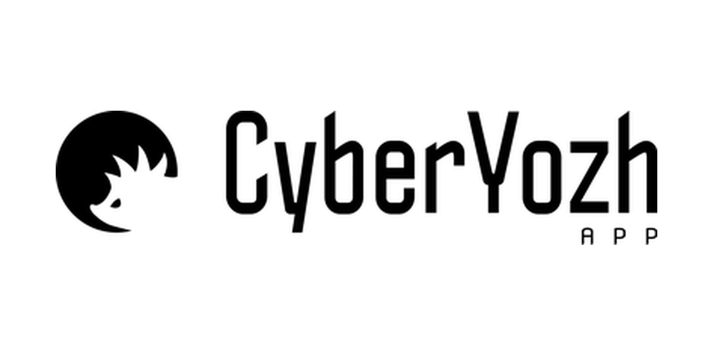

# CyberYozh App

CyberYozh App provides proxy infrastructure and digital tools for developers, businesses, and automation teams.

## Our Services

- **Mobile Proxies:** 4G/5G/LTE proxies with IP rotation and unlimited traffic options.
- **Residential Proxies:** Access to 100M+ residential IPs across 195+ countries.
- **ISP Proxies:** Static residential IPs for stable connections.
- **Datacenter Proxies:** Proxy solutions for data collection and automation.
- **Android Cloud Phones:** Cloud-based Android devices for app testing and remote device management.
- **SMS Activation:** Virtual numbers for receiving verification codes.
- **Virtual Cards & Risk Checks:** Tools for online payments and checking IP, phone, and card risks.

## Use Cases

Web scraping, SEO monitoring, market research, browser automation, geographic testing, and social media management.

## Technical Features

- HTTP/HTTPS and SOCKS5 support
- REST API access
- IP rotation and sticky sessions
- Geographic targeting
- Integration with Selenium, Playwright, Puppeteer, and Scrapy

## Get Started

Explore available proxy services and digital tools on the official CyberYozh App website.

**Website:** https://app.cyberyozh.com/
Sahar:
# CyberYozh Proxy Solutions

CyberYozh provides proxy solutions for developers, businesses, and digital professionals who need reliable IP connectivity and flexible geographic targeting.

## Proxy Services

- Residential proxies for accessing websites from different locations.
- Mobile proxies for mobile network-based connections and testing.
- Datacenter proxies for fast and scalable data operations.

## Mobile Proxy Solutions

For projects that require mobile network connections, explore [mobile proxies](https://app.cyberyozh.com/) and learn more about available proxy solutions.

## Official Website

Visit [CyberYozh](https://app.cyberyozh.com/) to explore its proxy services and features.

## Explore CyberYozh Proxy Solutions

CyberYozh offers flexible proxy solutions for developers, businesses, and digital professionals.

- [Mobile Proxies](https://app.cyberyozh.com/)
- [Residential Proxies](https://app.cyberyozh.com/proxy/residential-rotating/)
- [CyberYozh Official Website](https://app.cyberyozh.com/)

These solutions support web scraping, automation, testing, and other online workflows.
